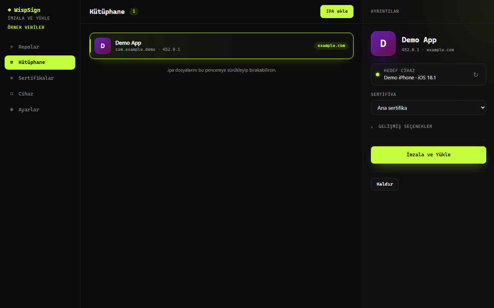
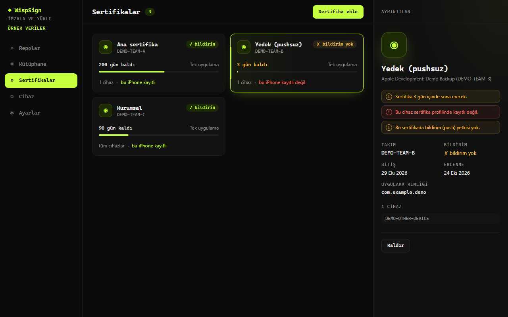
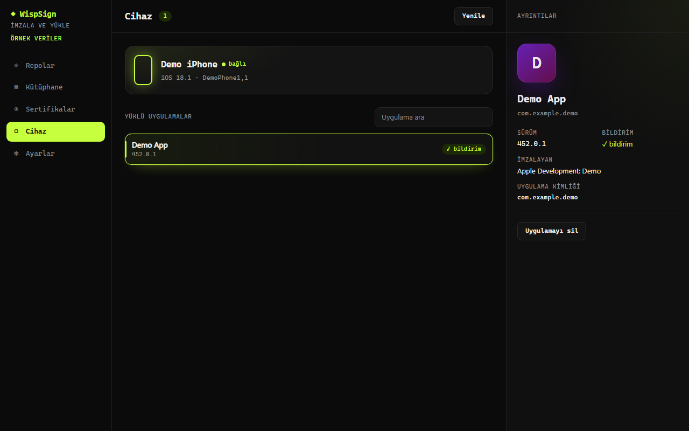
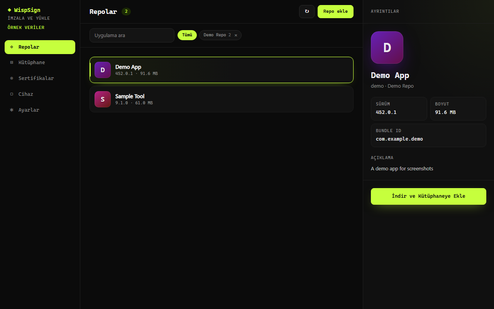

# WispSign

[Türkçe](README.tr.md)

WispSign is a Windows desktop app that re-signs iOS apps (`.ipa` files) with your own
certificate and installs them to an iPhone over USB. Signing is done by
[zsign](https://github.com/zhlynn/zsign); installation uses
[pymobiledevice3](https://github.com/doronz88/pymobiledevice3). Everything runs locally:
your certificates never leave your PC and passwords are stored encrypted with Windows DPAPI.



## Requirements

- Windows 10 or 11 (x64)
- **Apple Devices** (Microsoft Store) or iTunes, so Windows has the Apple USB driver
- Microsoft Edge WebView2 runtime (preinstalled on current Windows 10/11)
- An Apple signing certificate: a `.p12` file, its password and the matching
  `.mobileprovision` profile
- An iPhone connected by USB, unlocked, with "Trust this computer" accepted

## Install

Download `WispSign-Setup-<version>.exe` from the project's GitHub Releases page and run it. A portable
`.zip` is also published; unzip it and start `WispSign.exe`.

> The installer and `WispSign.exe` are not code-signed, so Windows SmartScreen may show a
> warning. Click "More info" and then "Run anyway".

## Quick start

1. **Add a certificate** (Certificates): enter a name and the `.p12` password, then press
   "Pick files" and choose the `.p12`, then the `.mobileprovision`. WispSign shows the
   days left, whether the profile covers your iPhone, and whether it allows push
   notifications.
2. **Add an IPA** (Library): click "Add IPA" or drop `.ipa` files onto the window. Apps can
   also be added from a repo you add yourself (Repos).
3. **Sign and install**: select the app, choose the certificate and press "Sign and
   Install". The bundle ID, display name and icon are under "Advanced options"; by
   default the original bundle ID is kept. Progress is shown live; the app appears on the
   connected iPhone when it finishes.

| Certificates | Device | Repos |
| --- | --- | --- |
|  |  |  |

The screenshots show the Turkish UI with demo data.

## Push notifications

Push only works when the app is signed with its original bundle ID and a provisioning profile
for an **explicit App ID that has the Push Notifications capability** (not a wildcard `*`
profile). Keep the bundle ID setting (under "Advanced options") on "Keep", the default, and pick a certificate whose
profile has push enabled; the Certificates page flags profiles without it.

Expired profiles, devices outside the profile and mismatched App IDs are rejected before
signing. After signing, the app's identity and push entitlements are compared with the
profile. This does not prove notification delivery; the
[device test procedure (Turkish)](docs/device-test.md) must also be completed.

## Limits

- Windows 10/11 x64 only; iPhone over USB only (no Wi-Fi install).
- A free or developer certificate has an expiry date; the app stops launching when the
  certificate or profile expires, and must be re-signed.
- The profile must include your iPhone's UDID or explicitly permit all devices.
- Wildcard profiles cannot provide push notifications or some entitlements.
- Repo data is untrusted: only `https://` URLs, repo JSON up to 5 MB, IPA downloads up to 4 GB,
  20 s timeout. IPAs with
  absolute or `..` paths, symlinks or more than 4 GB uncompressed are rejected.
- **No repos are shipped with the app.** You add repo URLs yourself and are responsible for
  the apps you sign and install.

See [security boundaries](docs/security.md) for password handling and the limits of local
profile and signature checks.

## Build from source

Requires Python 3.12, Node.js 22 and PowerShell.

```powershell
python -m venv .venv
.venv\Scripts\python -m pip install -c requirements-lock.txt -e ".[dev]"
packaging\build.ps1
```

The script fetches zsign (pinned SHA-256), builds the UI, runs PyInstaller and, when Inno
Setup (`iscc`) is installed, builds the installer. Output: `dist\WispSign\WispSign.exe` and
`dist\WispSign-Setup-<version>.exe`.

No personal release account is embedded in the app. To enable update checks, set
`WISPSIGN_UPDATE_REPO` to the public project's `owner/repository` at runtime.
Without it, the Settings page shows no update check.

### Development

Install as above (the `-c requirements-lock.txt` constraint keeps the same dependency
versions as the release build), then run the checks:

```powershell
.venv\Scripts\python packaging\fetch_zsign.py
.venv\Scripts\python -m pytest
.venv\Scripts\ruff check src tests packaging
cd ui; npm ci; npm run lint; npm run check; npm test; npx playwright test
```

## License

GPL-3.0-or-later, see [LICENSE](LICENSE). The bundled zsign binary keeps its own license in
[third_party/zsign/LICENSE](third_party/zsign/LICENSE).
